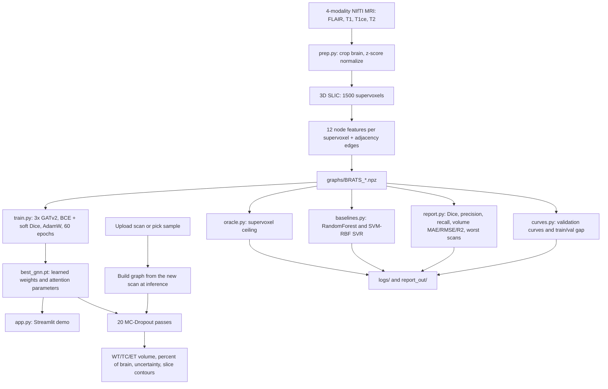

# Brain Tumor Segmentation and Tumor Volume with a Supervoxel Graph Neural Network

Brain MRI is converted into a supervoxel graph. A 3-layer GATv2 predicts the tumor
fraction for three nested regions (whole tumor, tumor core, enhancing). The system
outputs segmentation overlays, tumor volume in cm3, percentage of brain affected,
and MC-Dropout uncertainty.

## Working flowchart



## Tech used

| Component | Technology | Purpose |
|---|---|---|
| Language | Python 3.14 | All scripts |
| Deep learning | PyTorch, torch-geometric (GATv2Conv) | Graph model, training, inference |
| Graph construction | scikit-image (3D SLIC), NumPy | Supervoxels, 12 node features, edges |
| Medical imaging | NiBabel | Read/write NIfTI volumes |
| Classical ML | scikit-learn (RandomForestRegressor, SVR) | Baselines |
| Plots | Matplotlib | Metrics, scatter plots, learning curves |
| GUI | Streamlit | Interactive demo with sample scans |
| Reproducibility | Git, GitHub | Weights, logs, results, demo assets |

All dependencies are listed in `requirements.txt`.

## Data

Medical Segmentation Decathlon, Task01_BrainTumour: 484 labelled BraTS 2016/17
cases, license CC-BY-SA 4.0. This project uses the first 150 cases.

```
curl -L -O https://msd-for-monai.s3-us-west-2.amazonaws.com/Task01_BrainTumour.tar
tar -xf Task01_BrainTumour.tar
```

## Run

```
pip install -r requirements.txt
python test_smoke.py                       # sanity check, no dataset needed
python prep.py Task01_BrainTumour 150      # build graphs (150 of 484 cases used)
python train.py                            # GNN
python train.py --no_graph                 # ablation: same model, edges removed
python oracle.py                           # supervoxel ceiling
python baselines.py                        # RandomForest + SVM
python report.py best_gnn.pt               # metrics, plots, worst scans -> report_out/
python curves.py                           # val curves + train/val gap from saved weights
```

Demo on Windows: double-click `run_demo.bat`, or run
`C:\Python314\python.exe -m streamlit run app.py` with the Python that has torch and
nibabel. Choose a sample scan from the dropdown, move the slice slider, and save the
overlay PNG. The dropdown lists high-Dice demo scans first and keeps the worst cases
for error analysis.

## Results

150 MSD cases, patient-level 70/15/15 split (23 test scans). Values are mean +/- std
over three seeds. The Streamlit demo uses the seed-0 checkpoint.

| Model | Dice WT | Dice TC | Dice ET | Mean Dice | Vol MAE WT/TC/ET (cm3) |
|---|---|---|---|---|---|
| No graph (MLP) | 0.740 +/- 0.027 | 0.613 +/- 0.058 | 0.522 +/- 0.079 | 0.625 +/- 0.054 | 22.1 / 13.0 / 4.8 |
| Supervoxel GATv2 | 0.805 +/- 0.027 | 0.669 +/- 0.067 | 0.589 +/- 0.031 | 0.688 +/- 0.038 | 15.9 / 12.1 / 5.2 |
| RandomForest (seed 0) | 0.730 | 0.515 | 0.475 | 0.573 | 23.0 / 12.0 / 4.2 |
| SVM-RBF SVR (seed 0, 20k nodes) | 0.711 | 0.477 | 0.404 | 0.531 | 28.2 / 27.8 / 24.8 |
| Oracle ceiling (seed 0) | 0.859 | 0.775 | 0.634 | 0.756 | not applicable |

The graph improves mean Dice by +0.063 +/- 0.022, positive in all three paired seeds.
Oracle analysis shows that WT is near the supervoxel ceiling, TC has the largest
learnable gap, and ET is inherently limited by the supervoxel partition. Full
484-case training and external validation are future work.

`logs/` contains training logs. `report_out/` contains metrics, plots, worst scans,
learning curves and the train/val gap. `data/samples/` contains demo scans.

## Related work

- Saueressig et al., *Exploring Graph-Based Neural Networks for Automatic Brain Tumor Segmentation* (BraTS 2019)
- *A Joint Graph and Image Convolution Network for Automatic Brain Tumor Segmentation* (BraTS 2021, arXiv 2109.05580)
- Protani et al., *Decoder-Free Supervoxel GNN for Accurate Brain-Tumor Localization* (arXiv 2601.14055)
- Antonelli et al., *The Medical Segmentation Decathlon* (dataset)

Code was developed with AI assistance; all critical components were reviewed and
understood (see `evaluation_sheet.md`). Educational project, not a medical device.
